<div align="center">

# Draw2Draw 前端

**基于 Vue 3 + TypeScript 的智能协同云图库前端**

图片上传与在线编辑、个人 / 团队空间、WebSocket 实时协同、AI 生图与空间数据分析。

[](https://vuejs.org/)
[](https://www.typescriptlang.org/)
[](https://vitejs.dev/)
[](https://antdv.com/)

[前端仓库](https://github.com/X1aoM1ngTX/draw2draw-frontend) · [功能](#-功能模块) · [界面预览](#-界面预览) · [快速开始](#-快速开始) · [常见问题](#-常见问题)

</div>

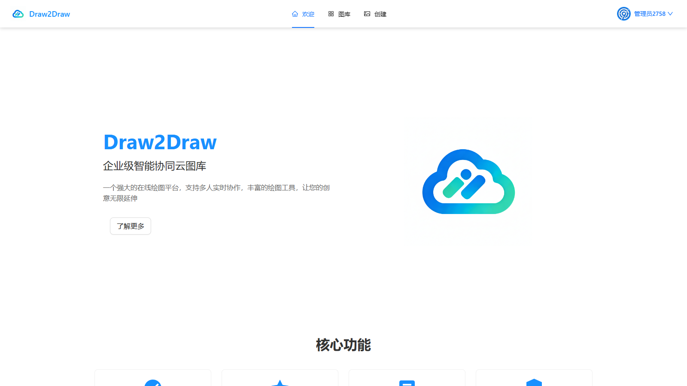

## 📖 简介

本仓库是 Draw2Draw 的前端应用，与 [draw2draw-backend](https://github.com/X1aoM1ngTX/draw2draw-backend) 配合使用。前端基于 Vue 3 Composition API 与 TypeScript 严格模式开发，使用 Vite 构建、Ant Design Vue 作为组件库、Pinia 管理状态，并通过 OpenAPI 自动生成后端接口代码。

界面全部为中文，覆盖图库浏览、图片编辑、空间协作、AI 生图、数据分析与管理后台等完整业务。

## 📸 界面预览

### 图库与图片

| 图库（瀑布流 + 分类 / 标签筛选） | 图片详情（预览、标签、分享） |
| --- | --- |
| 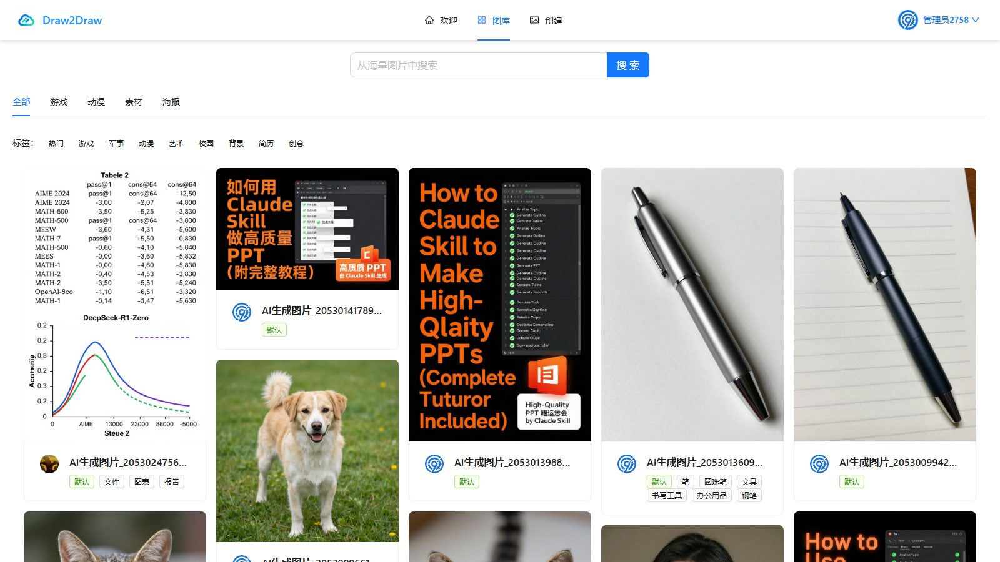 | 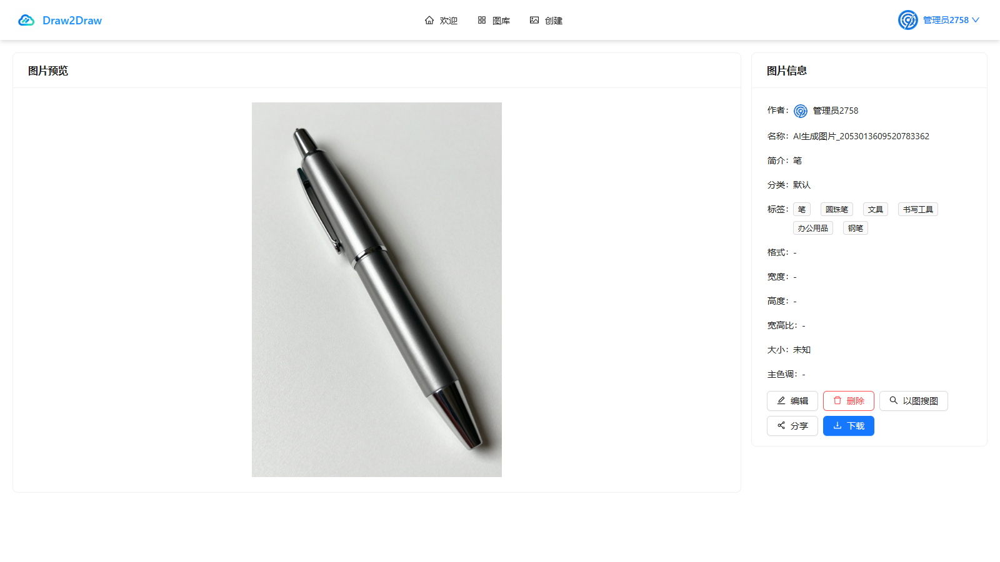 |

| 图片编辑（裁剪、AI 扩图、标签识别） | AI 生图（提示词、尺寸、额度） |
| --- | --- |
| 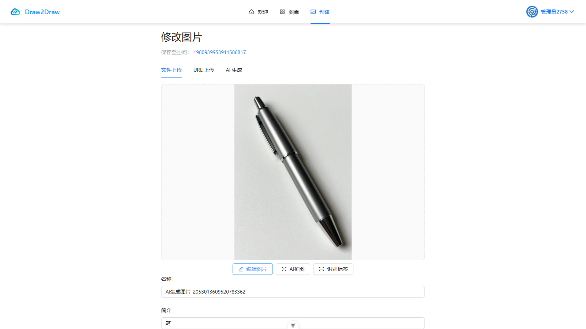 | 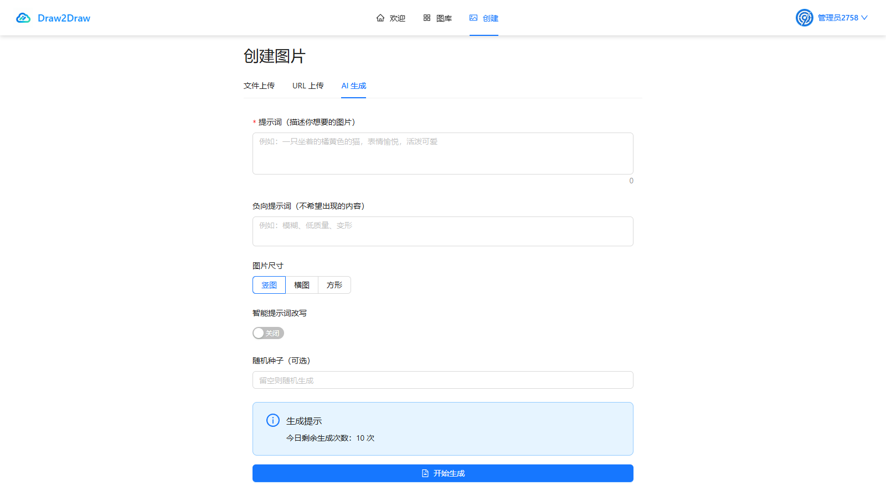 |

### 空间与协作

| 我的空间（私有 / 团队空间） | 空间详情（配额、搜索、批量操作） |
| --- | --- |
| 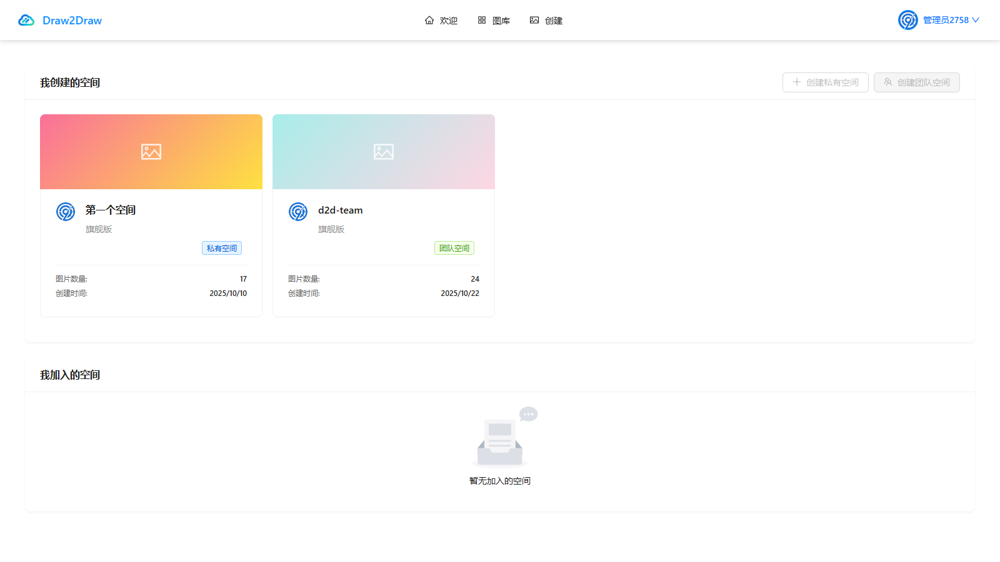 | 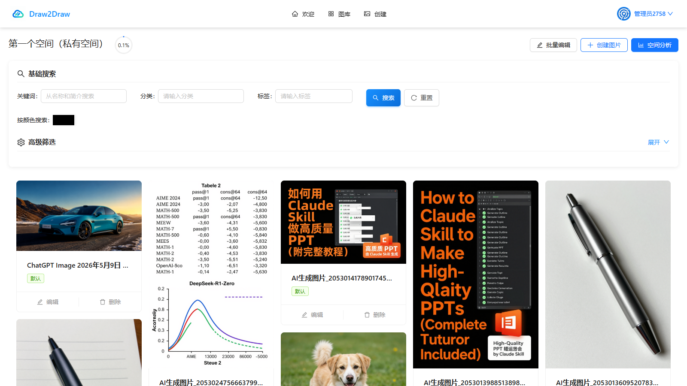 |

| 空间成员管理（角色与权限） | 空间数据分析（ECharts + 词云） |
| --- | --- |
| 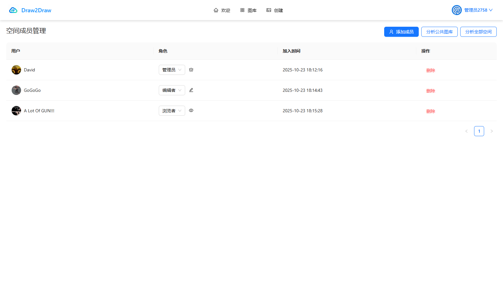 | 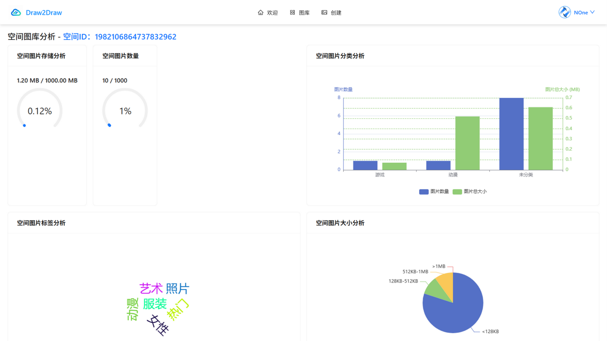 |

### 用户与管理后台

| 登录页 | 用户管理（管理员） |
| --- | --- |
| 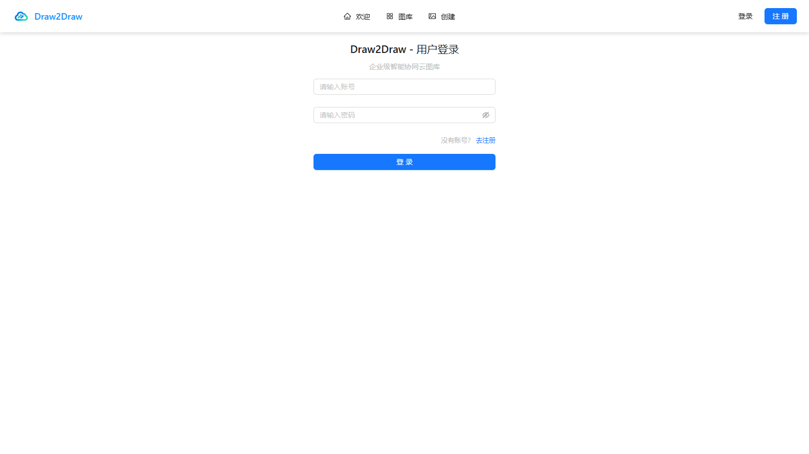 | 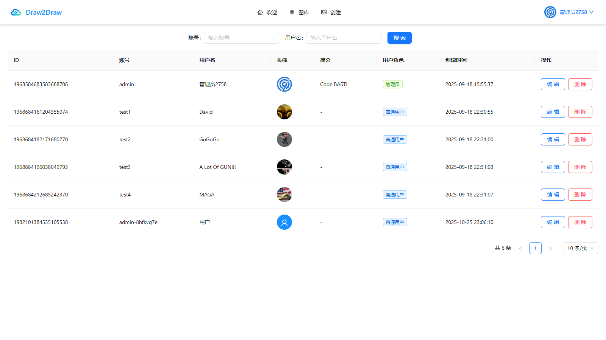 |

## ✨ 功能模块

### 用户

- 注册 / 登录 / 注销，登录态由 Cookie 会话维持并写入 Pinia
- 个人资料编辑、头像上传、VIP 兑换
- 管理员用户管理：搜索、编辑、删除、角色展示

### 图片

- 本地上传、URL 拉取、批量创建
- 在线裁剪、旋转、缩放、调色，AI 智能扩图与标签识别
- 瀑布流图库、关键词 / 标签 / 分类 / 颜色搜索、以图搜图
- 批量编辑、分享、下载、审核状态展示

### 空间

- 我创建的空间、我加入的空间
- 私有空间与团队空间，空间等级与容量配额
- 空间成员管理：邀请、角色调整（浏览者 / 编辑者 / 管理员）、移除
- 空间图片搜索与空间数据分析

### 实时协同编辑

- 同一团队空间图片多人同时在线
- 编辑锁：同一时刻仅一名成员可编辑
- 进入 / 退出编辑、旋转 / 缩放操作实时同步

### AI 生图

- 文生图 / 图生图表单，支持提示词、负向提示词、尺寸、随机种子
- 任务进度轮询、生成结果预览与一键入库
- 每日生成额度展示

## 🧰 技术栈

### 核心框架

- **Vue 3.5**：Composition API + `<script setup>`
- **TypeScript 5.6**：严格模式
- **Vite 6**：开发与构建（vite-plugin-vue-devtools、vite-plugin-html）

### UI 与交互

- **Ant Design Vue 4.2.6**：企业级组件库
- **Vue Router 4.4**：路由与权限守卫
- **Pinia 2.2**：状态管理（登录用户持久化到 localStorage）
- **vue-cropper**：图片裁剪
- **vue3-colorpicker**：调色与拾色
- **vue-waterfall-plugin-next**：瀑布流图库
- **file-saver**：文件下载
- **crypto-js**：AES / SHA-256 加密工具

### 数据与可视化

- **Axios 1.12**：HTTP 客户端（统一请求与错误处理）
- **ECharts 5.5 + vue-echarts**：空间数据图表
- **echarts-wordcloud**：标签词云

### 工程化

- **@umijs/openapi**：根据后端 Swagger 生成 `src/api`
- **ESLint 9 + Prettier 3 + vue-tsc**：代码检查、格式化、类型检查
- **npm-run-all2**：并行执行构建任务

## 📁 目录结构

```text
draw2draw-frontend/
├── public/                       # 静态资源（favicon）
├── src/
│   ├── api/                      # OpenAPI 生成的接口与类型（typings.d.ts）
│   ├── components/               # 业务组件
│   │   ├── PictureUpload.vue     # 本地图片上传
│   │   ├── UrlPictureUpload.vue  # URL 图片上传
│   │   ├── ImageCropper.vue      # 图片裁剪
│   │   ├── ImageOutPainting.vue  # AI 扩图
│   │   ├── AiImageGenerate.vue   # AI 生图
│   │   ├── BatchEditPictureModal.vue
│   │   ├── PictureList.vue / PictureSearchForm.vue
│   │   ├── ShareModal.vue
│   │   └── analyze/              # 空间分析图表组件
│   ├── pages/
│   │   ├── WelcomePage.vue       # 欢迎页（默认路由）
│   │   ├── picture/              # 图库 / 详情 / 创建 / 批量创建 / 以图搜图
│   │   ├── space/                # 我的空间 / 新建 / 详情 / 成员管理
│   │   ├── user/                 # 登录 / 注册 / 个人资料 / VIP 兑换
│   │   ├── admin/                # 用户 / 图片 / 空间管理
│   │   ├── analyze/              # 空间数据分析
│   │   └── error/                # 错误页
│   ├── access/                   # 前端权限判断
│   ├── layouts/                  # 布局、页头、页脚
│   ├── router/                   # 路由配置
│   ├── stores/                   # Pinia（useLoginUserStore）
│   ├── request/                  # Axios 封装
│   ├── constants/                # 图片 / 空间 / 用户常量与枚举
│   ├── utils/                    # WebSocket、加密、格式化、防抖
│   └── assets/                   # Logo 与图片资源
├── docs/screenshots/             # README 截图
├── openapi.config.ts             # 接口代码生成配置
├── vite.config.ts                # Vite 配置
├── eslint.config.js              # ESLint 配置
├── tsconfig*.json                # TypeScript 配置
└── package.json
```

## ⚙️ 环境变量

在项目根目录通过 `.env`、`.env.dev`、`.env.prod` 配置：

| 变量 | 说明 | 开发环境示例 |
| --- | --- | --- |
| `VITE_API_BASE_URL` | 后端 API 基础地址，接口请求统一加 `/api` 前缀 | `http://localhost:8090` |
| `VITE_WS_BASE_URL` | WebSocket 基础路径，前端会拼接当前页面的协议与域名 | `/api/ws` |

Vite 按模式加载环境文件：`npm run dev` 使用 `.env`，`build:dev` 使用 `.env.dev`，`build:prod` 使用 `.env.prod`。生产环境通常将 `VITE_API_BASE_URL` 留空，由 Nginx 反向代理 `/api`，实现同源访问。

> 修改环境变量后需要重启开发服务器。

> 💡 本地开发时前端（5173）与后端（8090）不同端口，WebSocket 需要同源代理。可在 `vite.config.ts` 中为 `/api` 配置 `server.proxy` 并开启 `ws: true`，或部署到 Nginx 同源环境后使用 `/api/ws`。

## 🚀 快速开始

### 环境要求

- **Node.js** 18+（推荐 20）
- **npm** 8+
- 已启动的 Draw2Draw 后端（默认 `http://localhost:8090`）

### 启动步骤

```bash
# 1. 安装依赖
npm install

# 2. 确认 .env / .env.dev 中的后端地址
#    VITE_API_BASE_URL=http://localhost:8090

# 3. 启动开发服务器
npm run dev

# 4. 访问 http://localhost:5173
```

后端需要先导入数据库并启动，具体步骤见[后端仓库](https://github.com/X1aoM1ngTX/draw2draw-backend)。

## 📜 常用命令

| 命令 | 说明 |
| --- | --- |
| `npm run dev` | 启动 Vite 开发服务器（默认 5173） |
| `npm run build` | 类型检查 + 生产构建 |
| `npm run build:dev` | 构建开发环境产物 |
| `npm run build:prod` | 构建生产环境产物 |
| `npm run preview` | 预览构建产物 |
| `npm run type-check` | TypeScript 类型检查（提交前必须通过） |
| `npm run lint` | ESLint 检查并自动修复 |
| `npm run format` | Prettier 格式化 `src/` |
| `npm run openapi` | 根据后端 Swagger 重新生成 `src/api` |

## 🔄 实时协同编辑

WebSocket 客户端封装在 `src/utils/pictureEditWebSocket.ts`：

```typescript
import PictureEditWebSocket from "@/utils/pictureEditWebSocket";
import {
  PICTURE_EDIT_MESSAGE_TYPE_ENUM,
  PICTURE_EDIT_ACTION_ENUM,
} from "@/constants/picture";

const websocket = new PictureEditWebSocket(pictureId);
websocket.connect();

// 监听其他协作者的编辑操作
websocket.on(PICTURE_EDIT_MESSAGE_TYPE_ENUM.EDIT_ACTION, (message) => {
  // 根据 message.editAction 同步旋转 / 缩放
});

// 进入编辑状态
websocket.sendMessage({
  type: PICTURE_EDIT_MESSAGE_TYPE_ENUM.ENTER_EDIT,
});

// 发送编辑操作
websocket.sendMessage({
  type: PICTURE_EDIT_MESSAGE_TYPE_ENUM.EDIT_ACTION,
  editAction: PICTURE_EDIT_ACTION_ENUM.ROTATE_LEFT,
});
```

消息类型：

| 类型 | 说明 |
| --- | --- |
| `INFO` | 系统通知 |
| `ERROR` | 错误提示 |
| `ENTER_EDIT` | 进入编辑状态 |
| `EXIT_EDIT` | 退出编辑状态 |
| `EDIT_ACTION` | 执行编辑操作（`ZOOM_IN` / `ZOOM_OUT` / `ROTATE_LEFT` / `ROTATE_RIGHT`） |

服务端端点：`/api/ws/picture/edit?pictureId={id}`。仅**团队空间**中有编辑权限的登录用户可建立连接；同一图片同一时刻仅允许一名协作者编辑。

## 🔐 登录态与权限

- 登录接口成功后，后端通过 Cookie 建立会话，前端将用户信息写入 `useLoginUserStore` 并持久化到 `localStorage`
- `src/access/` 负责前端权限判断，路由 `meta.access` 标记管理员页面
- 请求拦截器统一处理 `40100` 未登录响应，自动跳转登录页并携带 `redirect` 参数
- 空间内的可见 / 可编辑 / 可删除权限由后端返回的权限列表控制，前端仅做展示层兜底

## 🔌 接口代码生成

`src/api` 下的请求函数与 TypeScript 类型由 OpenAPI 自动生成。后端接口变更后执行：

```bash
npm run openapi
```

生成规则：

- 函数命名：`actionNameUsingMethod`，例如 `userLoginUsingPost`
- 类型统一挂在 `API.` 命名空间下
- 请求统一走 `src/request/request.ts` 的 Axios 实例

配置见 `openapi.config.ts`，默认从 `http://localhost:8090/api/v2/api-docs` 拉取文档。

## 📦 构建与部署

```bash
# 生产构建（会先执行类型检查）
npm run build:prod

# 产物输出到 dist/
```

Nginx 参考配置：

```nginx
server {
    listen 80;
    server_name your-domain.com;
    root /path/to/dist;
    index index.html;

    # 前端路由（history 模式）
    location / {
        try_files $uri $uri/ /index.html;
    }

    # 后端 API
    location /api {
        proxy_pass http://backend-server:8090;
        proxy_set_header Host $host;
        proxy_set_header X-Real-IP $remote_addr;
        proxy_set_header X-Forwarded-For $proxy_add_x_forwarded_for;
    }

    # WebSocket 升级（实时协同编辑）
    location /api/ws/ {
        proxy_pass http://backend-server:8090;
        proxy_http_version 1.1;
        proxy_set_header Upgrade $http_upgrade;
        proxy_set_header Connection "upgrade";
        proxy_set_header Host $host;
    }
}
```

也可以使用项目根目录的 `docker-compose.yml` 与前端的 `Dockerfile` 进行容器化部署。

## ❓ 常见问题

**Q：页面能打开，但接口全部 401 / 跨域失败？**

1. 确认后端已启动，且 `VITE_API_BASE_URL` 指向正确地址
2. 开发环境下前后端不同端口，需要后端允许跨域并携带 Cookie
3. 修改 `.env*` 后重启 `npm run dev`

**Q：WebSocket 连接失败？**

1. 确认图片属于**团队空间**，当前用户有编辑权限且已登录
2. 确认 `VITE_WS_BASE_URL` 与部署方式匹配：开发环境直连后端，生产环境由 Nginx 转发 `/api/ws/`
3. Nginx 需要配置 `Upgrade` / `Connection` 请求头（见上方配置）
4. 查看控制台中的连接 URL 与后端日志

**Q：图片上传失败？**

1. 检查后端 COS 配置是否正确
2. 文件大小不能超过 10MB
3. 打开浏览器控制台查看接口返回的具体错误信息

**Q：类型检查失败？**

运行 `npm run type-check` 查看具体错误。如果是后端接口变更导致，先执行 `npm run openapi` 重新生成类型，再修复调用处。

**Q：接口返回的数据结构与类型不一致？**

后端 Swagger 注解可能未更新，先确认 `http://localhost:8090/api/doc.html` 中的定义，再重新生成接口代码。

---

<div align="center">

如果这个项目对你有帮助，欢迎点一个 ⭐️ 支持一下！

</div>
